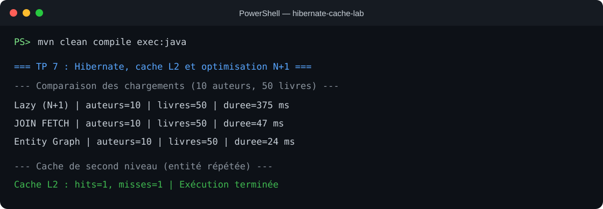

# TP 7 : Activation du cache de second niveau, optimisation des performances et suppression du problème N+1 avec JOIN FETCH et Entity Graph

Projet Maven/JPA qui illustre les chargements d'associations `LAZY`, la réduction du problème N+1 avec `JOIN FETCH` et `EntityGraph`, puis le cache Hibernate de second niveau avec Ehcache et une base H2 en mémoire.

## Description du TP

Le programme crée 10 auteurs avec 5 livres chacun (50 livres), puis compare quatre parcours de chargement. Les temps affichés sont ceux de la machine au moment de l'exécution; ils ne sont pas des valeurs de référence fixes.

- Chargement `LAZY` pour rendre visible le cas N+1.
- `JOIN FETCH` avec `DISTINCT` pour charger les auteurs et leurs livres ensemble.
- `EntityGraph` nommé `Auteur.livres` pour choisir les associations à charger.
- Cache de second niveau Ehcache avec régions d'entités et de collection; une lecture répétée affiche aussi les statistiques de cache.

## Prérequis

- JDK 8 ou supérieur
- Maven 3.6 ou supérieur

Le TP suit l'exemple du lab sur Hibernate 5 et JPA 2.2. `hibernate-jcache` est utilisé avec Ehcache 3 afin que l'adaptateur et le fournisseur JCache soient compatibles.

## Exécution dans le terminal

Depuis la racine du dépôt :

```bash
mvn clean compile exec:java
```

La base H2 est créée en mémoire et supprimée à la fermeture du processus. Aucune installation de serveur de base de données n'est nécessaire.

## Résultat attendu

Le terminal affiche la génération des schémas SQL, l'insertion des données et les mesures pour `Lazy (N+1)`, `JOIN FETCH`, `Entity Graph` et `Cache L2`. Les temps varient selon l'environnement. La dernière lecture réutilise les résultats mis en cache; les compteurs Hibernate indiquent l'activité du cache.

## Capture d'exécution

L'application a été compilée et lancée avec `mvn clean compile exec:java`. La capture ci-dessous reprend les lignes de résultat du terminal : les quatre parcours chargent les 10 auteurs et les 50 livres, et la seconde lecture de l'auteur montre un hit du cache de second niveau.



Les durées dépendent de la machine. Le premier chargement `LAZY` émet une requête pour les auteurs puis des requêtes supplémentaires pour les collections; `JOIN FETCH` et `EntityGraph` chargent les associations dans la requête de lecture. Le test final effectue deux lectures séparées par un nettoyage du contexte de persistance : le second accès réutilise l'entité mise en cache.

## Organisation

```text
src/main/java/com/example/
  App.java
  model/Auteur.java
  model/Livre.java
  service/DataInitService.java
  service/PerformanceTestService.java
src/main/resources/
  META-INF/persistence.xml
  ehcache.xml
```
